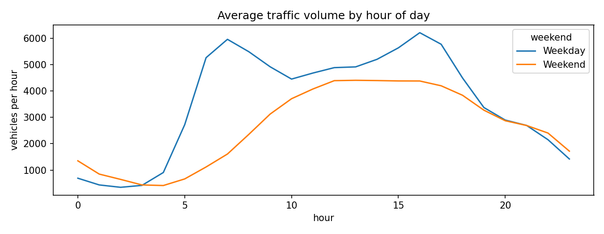
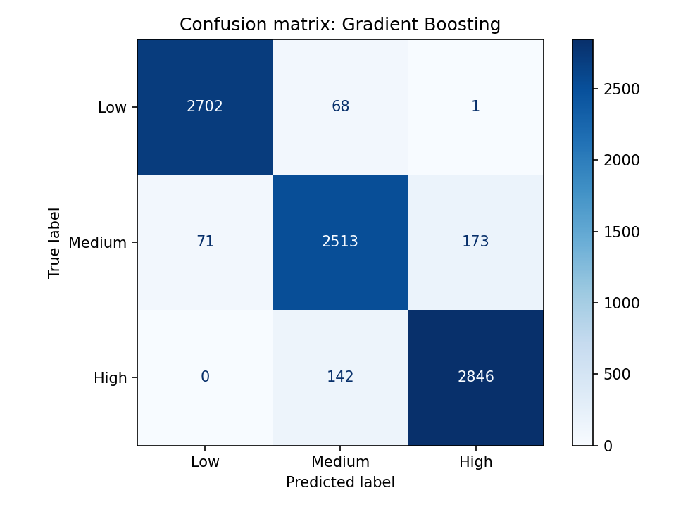
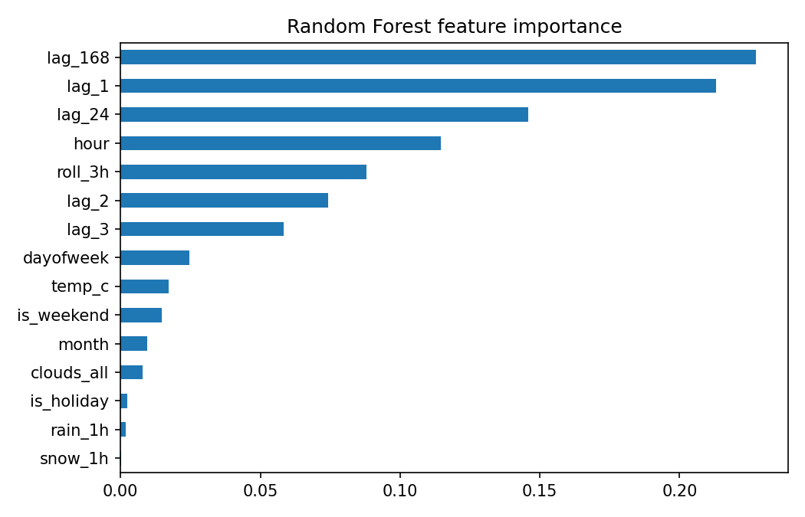

# Traffic Congestion Prediction: Low / Medium / High

Predicts the congestion level of the next hour on a US highway (I-94, Minneapolis-St Paul) from the calendar, the weather and recent traffic, and compares four approaches.

## Problem
Can machine learning classify next-hour traffic as Low, Medium or High better than a simple "same as the previous hour" rule?

## Data
- Source: Metro Interstate Traffic Volume dataset, UCI Machine Learning Repository
- Hourly traffic volume and weather, 2012 to 2018
- Cleaning: removed duplicate timestamps, replaced impossible values (0 K temperatures, extreme rainfall) and filled short gaps (up to 6 hours) by interpolation

## Method
1. Built features: hour, day of week, month, weekend, holiday, weather, traffic 1, 2, 3, 24 and 168 hours earlier, and a 3-hour rolling average
2. Defined congestion levels from the training period only: Low (bottom third of traffic volume), Medium (middle third), High (top third)
3. Split chronologically: first 80% train, last 20% test (no shuffling)
4. Models: Persistence baseline, Logistic Regression, Random Forest (200 trees), Gradient Boosting
5. Metrics: accuracy and macro F1

## Results

| Model | Accuracy (%) | Macro F1 |
|---|---|---|
| Persistence baseline (previous hour's level) | 80.4 | 0.802 |
| Logistic Regression | 90.0 | 0.900 |
| Random Forest | 94.5 | 0.945 |
| Gradient Boosting | 94.7 | 0.946 |

## Key findings
- Gradient Boosting and Random Forest were the best models, with accuracy near 94.5%. The 0.2-point gap between them is too small to call one better.
- Both clearly beat the persistence baseline (about 14 points higher) and Logistic Regression (about 4.5 points higher).
- The most important features were traffic one week earlier (`lag_168`), one hour earlier (`lag_1`) and one day earlier (`lag_24`), followed by the hour of day. Rain, snow and temperature contributed very little.
- In the confusion matrix (Gradient Boosting, 8,516 test hours), almost all mistakes were between neighbouring levels (Low vs Medium, Medium vs High). Only 1 hour was confused between Low and High.
- Weekdays show a morning peak around 7 am and a larger afternoon peak around 4 pm (about 6,000 vehicles per hour), while weekends show a single smoother midday peak (about 4,400).

## Limitations
- One highway in one city, data from 2012 to 2018
- Congestion levels are relative to this dataset (based on traffic volume terciles), not an official standard
- Single chronological split; no hyperparameter tuning or walk-forward validation

## Next steps
- Tune hyperparameters and test walk-forward validation
- Try a sequence model such as an LSTM
- Add events, incidents and forecasted weather

## How to run
1. Open the notebook file in this repository using Google Colab
2. Click Runtime, then Run all
3. The dataset is downloaded automatically; results and charts are saved as image and CSV files

## Tools
Python, Pandas, NumPy, Scikit-learn, Matplotlib
